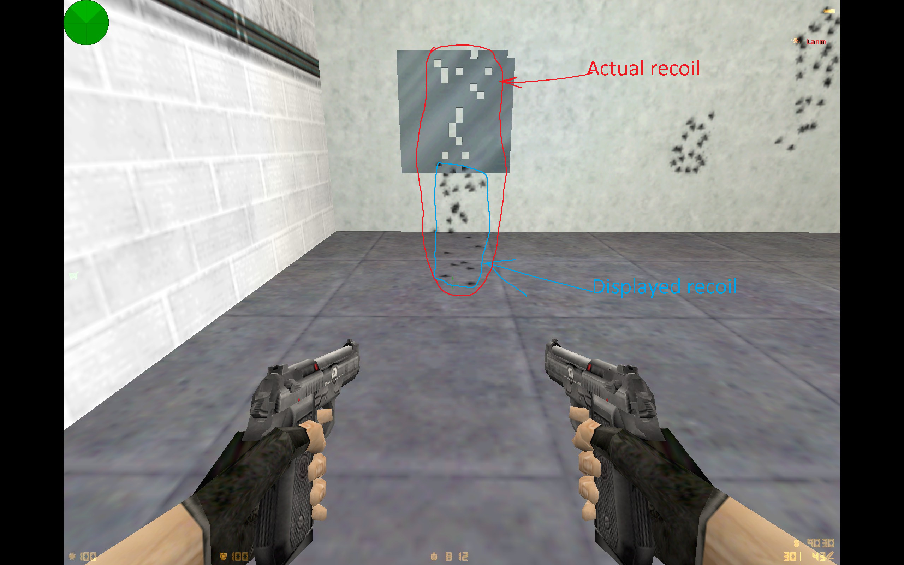

# Elites Recoil Fix (AMX Mod X)

An AMX Mod X plugin for Counter-Strike 1.6 that fixes a mismatch between where the Dual Elites appear to hit and where their bullets actually go.

## The Problem

When the stock Dual Elites are fired very quickly, the bullets hit above the bullet marks they leave. The marks sit at about half the angle between the crosshair and the real hit, so they can look like they are right on an opponent while the opponent takes no damage.

The bug was reported by satnatantas in [ValveSoftware/halflife#2822](https://github.com/ValveSoftware/halflife/issues/2822), which is still open. According to the report, it appears at about 10 to 13 shots per second and does not depend on `cl_lw`. It does not show on servers running ReGameDLL, where the fire rate of the Dual Elites is reduced.

The screenshots below are from that report. In the first one, the broken glass shows where the bullets really went, compared with the bullet marks below it.

The next two were taken with a tracer plugin. The colored lines rise about twice as far as the bullet marks.

## The Fix

The plugin hooks `Ham_Weapon_PrimaryAttack` on `weapon_elite` after each shot and multiplies `pev_punchangle` by `RECOIL_MULT`, which is 0.5 by default. With the recoil halved, the bullets land where the marks show. I confirmed this by testing in game.

The fix is an AMX Mod X plugin, so it only applies on servers that run it. It does not change the game itself or fix the bug on other servers.

`RECOIL_MULT` is a `#define` at the top of `elites_fix.sma`, so changing it requires recompiling.

## Installation

1. Copy `elites_fix.amxx` to `cstrike/addons/amxmodx/plugins/`.
2. Add `elites_fix.amxx` to `cstrike/addons/amxmodx/configs/plugins.ini`.

## Requirements

AMX Mod X with the fakemeta and hamsandwich modules.

## License

MIT
