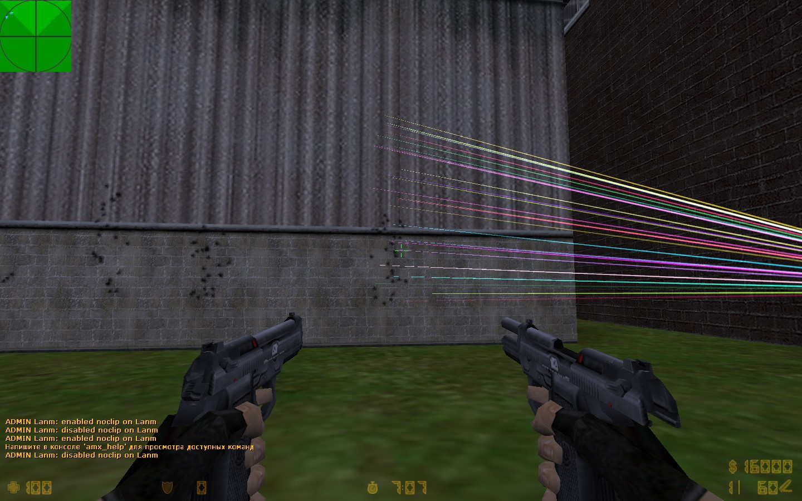
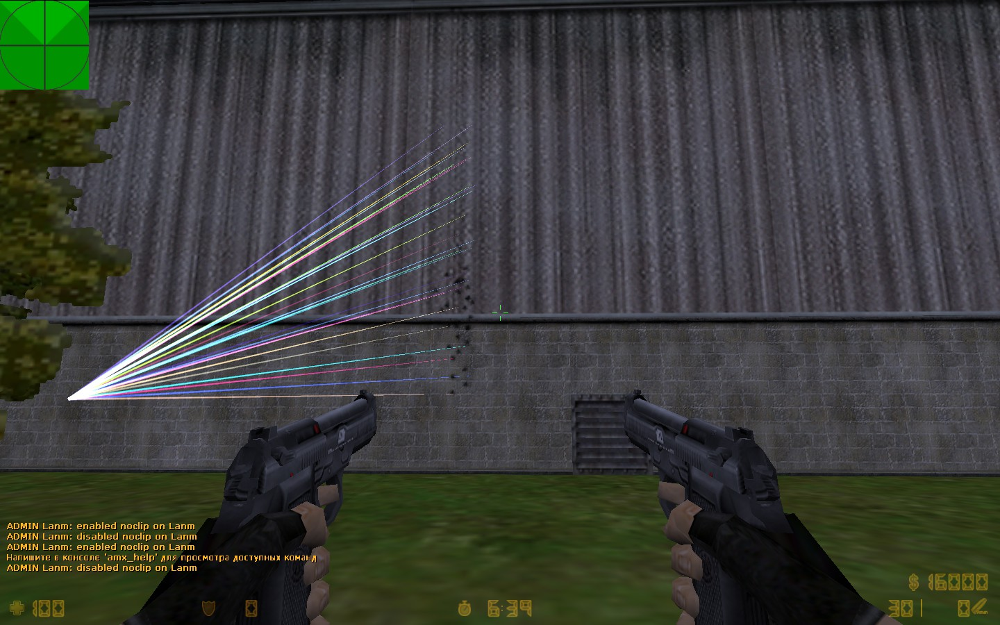

# Elites Recoil Fix (AMX Mod X)

An AMX Mod X plugin for Counter-Strike 1.6 that fixes a mismatch between where the Dual Elites appear to hit and where their bullets actually go.

## The Problem

With the stock Dual Elites, bullets land above the bullet marks they leave on the wall, at about twice the visible recoil. The marks can look like they are right on an opponent while the opponent takes no damage.

The screenshots below show the problem with the stock weapon. The bullet marks stay low on the wall, while the colored lines rise roughly twice as far.

These screenshots were taken by another player who noticed the same issue. I do not know their original source. If they are yours, please open an issue so I can credit you or remove them.

## The Fix

The plugin hooks `Ham_Weapon_PrimaryAttack` on `weapon_elite` after each shot and multiplies `pev_punchangle` by `RECOIL_MULT`, which is 0.5 by default. With the recoil halved, the bullets land where the marks show. I confirmed this by testing in game.

`RECOIL_MULT` is a `#define` at the top of `elites_fix.sma`, so changing it requires recompiling.

## Installation

1. Copy `elites_fix.amxx` to `cstrike/addons/amxmodx/plugins/`.
2. Add `elites_fix.amxx` to `cstrike/addons/amxmodx/configs/plugins.ini`.

## Requirements

AMX Mod X with the fakemeta and hamsandwich modules.

## License

MIT
